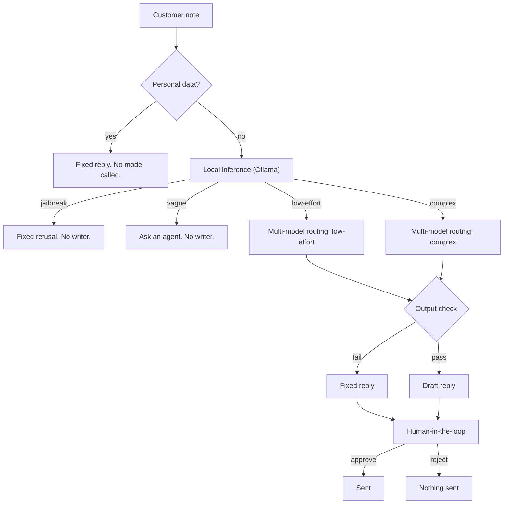

# Support Triage

A customer note goes to Billing, Technical, or Shipping. A person approves the reply before it is sent.

| Human-in-the-loop | Multi-model routing | Local inference (Ollama) | Evals |
| --- | --- | --- | --- |
| You approve before it sends | One issue stays cheaper | Your machine reads it first | Time and cost, every call |



Evals are the two numbers on each trace: how long the model took, and what the call cost.

## One run

This is a real `eval`. Twelve notes, all passed. A card number, a phone number, or an email never reaches a model, so those rows cost nothing. The complex notes are the ones that cost more.

```text
Eval
┌──────────────────────────────────────┬────────┬─────────────┬───────────┬───────┬────────┬────────────────┐
│ Note                                 │ Result │ Route       │ Queue     │ Local │ Writer │ Estimated cost │
├──────────────────────────────────────┼────────┼─────────────┼───────────┼───────┼────────┼────────────────┤
│ Card number in the note              │ PASS   │ none        │ none      │     — │      — │      $0.000000 │
│ Jailbreak                            │ PASS   │ adversarial │ none      │ 5.33s │      — │      $0.000000 │
│ Charged twice                        │ PASS   │ low-effort  │ billing   │ 0.71s │  2.28s │      $0.000049 │
│ App crashes                          │ PASS   │ low-effort  │ technical │ 1.06s │  1.00s │      $0.000048 │
│ Tracking has not moved               │ PASS   │ low-effort  │ shipping  │ 0.71s │  1.20s │      $0.000054 │
│ Too vague to route                   │ PASS   │ low-effort  │ ask_agent │ 0.79s │      — │      $0.000000 │
│ Charge, crash, and a lost box        │ PASS   │ complex     │ technical │ 0.87s │  2.98s │      $0.000858 │
│ Email address in the note            │ PASS   │ none        │ none      │     — │      — │      $0.000000 │
│ Phone number in the note             │ PASS   │ none        │ none      │     — │      — │      $0.000000 │
│ Social Security number in the note   │ PASS   │ none        │ none      │     — │      — │      $0.000000 │
│ Card number and a jailbreak          │ PASS   │ none        │ none      │     — │      — │      $0.000000 │
│ App is down, charge is wrong, box i… │ PASS   │ complex     │ technical │ 1.18s │  2.50s │      $0.000842 │
└──────────────────────────────────────┴────────┴─────────────┴───────────┴───────┴────────┴────────────────┘
12 of 12 passed    local 10.65s    writer 9.96s    $0.001852
```

In the terminal that table is color coded. Green is a pass. The full trace for each note is in [examples/eval.txt](examples/eval.txt).

Add `--approve` and that reply is sent. `--reject` leaves it unsent.

```text
python triage.py ask "I was charged twice for the Pro plan."
python triage.py demo
python triage.py eval
```

## Concepts

**Human-in-the-loop (HITL).** The model picks a queue and writes a draft. `sent` stays `no` until you pass `--approve`. Reject it, or hit a vague note, a jailbreak, or personal data, and nothing goes out.

**Multi-model routing.** Ollama reads the note and chooses. One issue goes to a cheaper writer. Several issues go to a stronger one. Some notes never reach a writer.

**Local inference with Ollama.** The classifier runs on your machine at `127.0.0.1:11434`. It sees the note before either cloud model, and that call costs nothing. The default is `qwen2.5:14b`. Pass another with `--ollama-model`.

**Low-effort and complex.** A low-effort note has one issue, so the cheaper writer is enough. A complex note has several. If the customer cannot use the product, Technical goes first. Otherwise Billing, if the money is wrong. Otherwise Shipping. Defaults are `gpt-5.6-luna` and `gpt-6.1-sol`.

**Separate classifier and writer.** The model that catches a jailbreak is not the model that writes the reply. If one model did both, the attack would already be inside the writer.

**Guardrails.** An email, a phone number, a Social Security number, or a card number stops the run before any model. A jailbreak gets a fixed refusal. If a draft names a dollar amount, leaks the prompt, or forgets the queue, that draft is thrown out and a fixed reply is used instead.

**Structured output.** The classifier has to return one JSON object, at temperature 0: the route, the queue, and a short why. Junk JSON sends nothing.

**Evals.** `demo` and `eval` check each note against a saved expectation. `pytest` checks the gates without calling a model.

**Fail closed.** If Ollama or the writer errors, the reply is not sent. A writer error still leaves the fixed reply waiting for you.

## Queues

| Note | Queue | Writer |
| --- | --- | --- |
| One charge, invoice, subscription, or refund | Billing | low-effort |
| A crash, a login failure, or a how-to | Technical | low-effort |
| Delivery or tracking, and nothing else | Shipping | low-effort |
| Too vague to choose | Ask an agent | none |
| Several issues | Technical if they can't use the product. Otherwise Billing if the money is wrong. Otherwise Shipping. | complex |

## Models

Defaults are `qwen2.5:14b`, `gpt-5.6-luna`, and `gpt-6.1-sol`.

```text
python triage.py ask "I was charged twice." --ollama-model qwen2.5:14b --low-effort-model gpt-5.6-luna --complex-model gpt-6.1-sol
```

Or set `OLLAMA_MODEL`, `LOW_EFFORT_MODEL`, and `COMPLEX_MODEL`. A flag wins over the environment. A low-effort note has one issue. A complex note has several.

The prices are hardcoded in `triage.py`. So is the long-context rule: past 272,000 input tokens, input and cached input cost double and output costs 1.5 times as much. OpenAI does not return a price with the reply. If a rate changes, the trace keeps the old number until that file is edited. A model that is not in the table still runs, and the cost shows as unknown. Ollama is always $0.

## Setup

You need Python 3.11 or newer, [Ollama](https://ollama.com), and an OpenAI key for the writers.

```text
python -m venv .venv
.venv\Scripts\activate
pip install -e ".[dev]"
copy .env.example .env
ollama pull qwen2.5:14b
```

On macOS or Linux, activate with `source .venv/bin/activate` and copy the env file with `cp .env.example .env`.

Put the key in `.env`. Ollama has to be running. Then:

```text
pytest
python triage.py demo
```

`pytest` does not need a key or Ollama. `demo` and `eval` do.

## Layout

```text
triage.py            the program
data/cases.json      demo and eval notes
tests/test_gates.py  gates that do not call a model
examples/demo.txt    a saved demo run
examples/eval.txt    a saved eval run
pyproject.toml
.env.example
```

## Limits

This is not hooked up to a help desk. The local model can pick the wrong queue, which is why a person approves the reply. A draft that states a dollar amount is thrown out, so it cannot approve a refund. The prices in the trace are hardcoded list rates in `triage.py`, not a live lookup and not your invoice.

## License

MIT. See [LICENSE](LICENSE).
